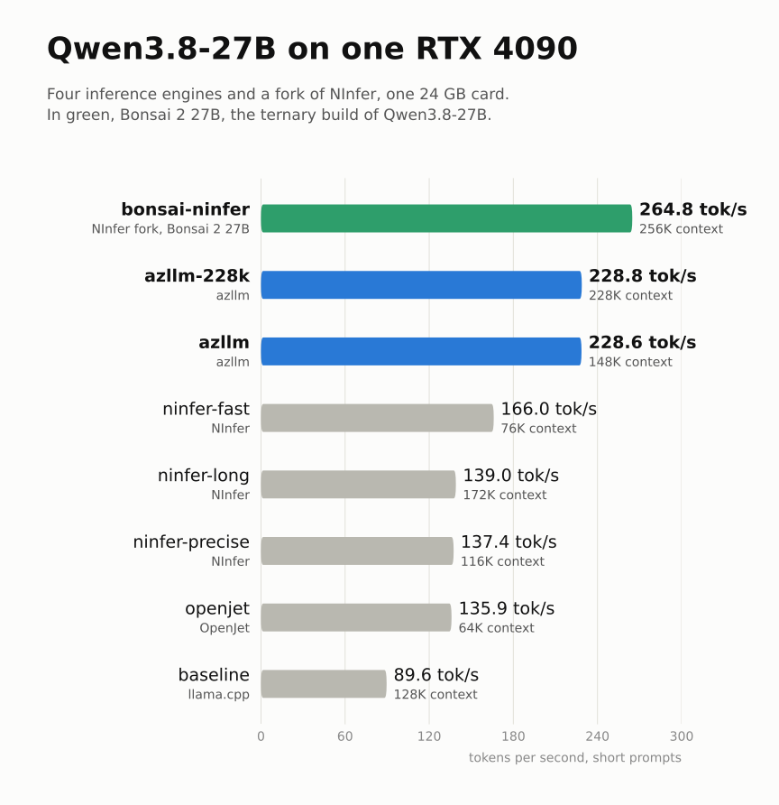

# qwen-4090-bench

[](https://github.com/kineticsystem/qwen-4090-bench/actions/workflows/ci.yml)

This repository is a benchmark. I wanted to know how to run a large language model on my own computer, with one **NVIDIA GeForce RTX 4090** (24 GB), as fast as possible and without losing quality.

I used one model, **Qwen3.8-27B**, and compared four different *inference engines*:

- **llama.cpp**, the usual choice, as the reference: the baseline;
- **OpenJet**, **NInfer** and **azllm**, three engines written specially for this family of models.

I also tried **Bonsai 2 27B**, PrismML's ternary build of Qwen3.8-27B: the same model, with each weight quantized to -1, 0 or +1, on a fork of NInfer that reads it.

<p align="center"></p>

At full precision the model does not fit in 24 GB, so each engine uses a compressed copy of it, a *quantized* model, with about 4 to 5 bits per weight instead of 16. llama.cpp and OpenJet read the same file; NInfer and azllm each read a format of their own, so their copies differ slightly. Bonsai goes much further, with less than 2 bits per weight: 6.4 GB instead of about 19 GB.

For each engine I measured the speed, the accuracy, the largest context that fits on the card, with and without the model's vision, and how much precision is lost by compressing the memory of the context, the KV cache. For Bonsai I measured only the speed.

The best engine, azllm, is 2.5 times faster than llama.cpp, as precise, and has the most context: 228K tokens with vision, while leaving 2 GB of the card free for the display. Bonsai on NInfer is faster still, 264.8 tok/s with its full context of 256K tokens in 11.7 GB of the card, as good at arithmetic, but it solves 150 of 164 HumanEval coding problems against 157 for azllm. The details are in the [research report](doc/research/REPORT.md) and the [paper](doc/research/Serving-Qwen3.8-27B-on-a-single-RTX-4090.pdf).

The repository also packages every configuration I measured, ready to use: one Docker container with the four engines, the fork of NInfer for Bonsai, and [llama-swap](https://github.com/mostlygeek/llama-swap), which starts the engine a request asks for. Any program that speaks the OpenAI API can use it. I used the coding agent [opencode](https://opencode.ai), and provide a script that configures it.

> [!IMPORTANT]
> This project is built and tuned for the RTX 4090 (24 GB, `sm_89`) only. The engines are compiled for that GPU, and the context sizes fill its memory, less the room the display needs: see [Room for the Display](#room-for-the-display).

## Table of Contents <!-- omit in toc -->

- [The Results](#the-results)
- [What Bonsai Shows About Qwen3.8](#what-bonsai-shows-about-qwen38)
- [Prerequisites](#prerequisites)
- [Install](#install)
- [Use It](#use-it)
  - [opencode](#opencode)
- [The Commands](#the-commands)
- [Change a Model](#change-a-model)
- [Fixes to the Engines](#fixes-to-the-engines)
- [Room for the Display](#room-for-the-display)
- [Troubleshooting](#troubleshooting)
- [Licenses](#licenses)

## The Results

Decode speed on six short prompts, with the recommended sampling and thinking off, and accuracy with greedy decoding. The first column is the name a client asks for:

| Model | Engine | Context | Vision | Speed | GSM8K | HumanEval |
|---|---|---:|:---:|---:|---:|---:|
| `baseline` | llama.cpp (TurboQuant fork) | 128K | yes | 89.6 tok/s | 97.2% | 96.3% |
| `openjet` | OpenJet | 64K | no | 135.9 tok/s | 95.6% | 96.3% |
| `ninfer-precise` | NInfer | 116K | yes | 137.4 tok/s | 97.6% | 95.1% |
| `ninfer-long` | NInfer | 172K | yes | 139.0 tok/s | 96.0% | 96.3% |
| `ninfer-fast` | NInfer | 76K | yes | 166.0 tok/s | 97.2% | 95.7% |
| **`azllm`** | azllm | 148K | yes | **228.6 tok/s** | 95.2% | 95.7% |
| **`azllm-228k`** | azllm | **228K** | yes | **228.8 tok/s** | 96.8% | 95.7% |
| `bonsai-ninfer` | NInfer fork, Bonsai 2 27B | 256K | no | 264.8 tok/s | 96.0% | 91.5% |

**azllm is the best of the engines I tested.** It is 2.5 times faster than the baseline, about 300 tok/s on code, and as precise: its weights predict code within 0.5% of the baseline's, and the accuracy differences are within the noise of the tests.

The context is the one each model is served with here, which keeps 2 GB of the GPU free for the display: see [Room for the Display](#room-for-the-display). The research measured the speeds and scores at larger contexts, which left each engine only its default free memory, e.g. 768 MiB for azllm; the speed hardly depends on the context size.

For long coding sessions, use **`azllm-228k`**: it has the most context, its 4-bit KV cache costs almost nothing in precision, and it is as fast on short prompts.

**Bonsai 2 27B is faster, but writes worse code.** `bonsai-ninfer` decodes 16% faster than azllm, with the model's full context in 11.7 GB of the card. On GSM8K it solves 240 of 250 problems, within the noise of the Qwen3.8 models (238 to 244). On HumanEval it solves 150 of 164, against 156 to 158 for every Qwen3.8 model: that gap is larger than the noise, most likely the price of its ternary weights. It suits work where speed and context matter more than the last points of precision.

How the measurements were made, and how to reproduce them, is in the [research report](doc/research/REPORT.md). The image at the top is drawn by [`doc/img/summary.py`](doc/img/summary.py), from these speeds and `bonsai-ninfer` measured the same way, at 256K: change its list and run it again when a result changes.

## What Bonsai Shows About Qwen3.8

Bonsai 2 27B is PrismML's ternary build of Qwen3.8-27B: the same architecture with weights -1, 0 or +1. On NInfer, with its full context of 256K tokens, it decodes 264.8 tok/s on the six short prompts of [The Results](#the-results), against 228.6 for azllm, the fastest engine with Qwen3.8 (see [Use It](#use-it)). Two things make it fast, and only one of them carries over to Qwen3.8:

- **The ternary weights.** NInfer reads 6.4 GB per token instead of about 19 GB, which is most of the gain on prose. Qwen3.8 cannot have it without losing precision.
- **The drafts.** Bonsai runs with MTP 3 and n-gram drafts, `--ngram chain --ngram-n 4`. The n-gram drafts copy text that is already in the context, so a round that repeats code, JSON, a tool call or a file being edited accepts 10 tokens or more. A short key of 4 tokens is the fastest on new text: 350 tok/s on code, against 312 with the default of 8. On prose there is nothing to copy, and the speed does not change.

The retrained MTP layer of Bonsai does not carry over: Qwen3.8's MTP layer is its own, trained on its outputs.

**NInfer.** `engines/ninfer-4090`, which the `ninfer-*` models run, has no n-gram drafts. JGamboa's fork, `engines/ninfer-bonsai`, has them, and reads Qwen3.8 too, including the official artifact that [`scripts/download-models.sh`](scripts/download-models.sh) saves as `ninfer/qwen3_8_27b_dflash2.ninfer`. The fork's author measured Qwen3.8 on Windows, with the same RTX 4090 and `rk4v4-e8` KV, thinking off unless the row says otherwise:

| Workload | MTP 3 | MTP 3 + n-gram | DFlash2, 6 drafts |
|---|---:|---:|---:|
| Edit-style prompts | 152 tok/s | **289 tok/s** | 215 tok/s |
| Prose | 97 tok/s | 97 tok/s | 96 tok/s |
| Server, edits of 7K-11K-token files, thinking on | not measured | **258 tok/s** | 139 tok/s |

The n-gram drafts cost a second set of CUDA graphs, about 2.5% of the KV memory, so the context that leaves 2 GB free for the display is a little smaller. The fork also publishes [`jgamboa/Qwen3.8-27B-NInfer-4090`](https://huggingface.co/jgamboa/Qwen3.8-27B-NInfer-4090), `qwen3_8_27b_a8_mtpq4q5.ninfer`, 18.9 GiB: the same main weights, byte for byte, with int8 prefill, which processes a prompt about 1.9 times faster (a 64K-token prompt in 14.8 s instead of 27.5 s), and a Q4/Q5 MTP layer, about 3% faster decode.

**llama.cpp.** The Bonsai model on upstream llama.cpp, `bonsai-llamacpp`, uses no drafts, so it has nothing to give the baseline. The TurboQuant fork that the baseline runs can take several draft types, e.g. `--spec-type ngram-mod,draft-mtp`, but it does not chain them as NInfer does: for each round it uses the first type that drafts anything, n-gram drafts when the context has a match and MTP otherwise. It also has `--spec-chain` and an adaptive MTP depth, `draft-mtp-adaptive`. The baseline uses MTP with 2 drafts alone.

> [!NOTE]
> None of this is measured in this repository yet. On prose, azllm, at 228.6 tok/s, stays the fastest; on code and edits, NInfer with n-gram drafts may catch up with it.

## Prerequisites

- **An NVIDIA GeForce RTX 4090** and its driver, version 580 or newer.
- **Linux, Docker and the NVIDIA Container Toolkit.** Please refer to [Install Docker Engine on Ubuntu](https://docs.docker.com/engine/install/ubuntu/) and [Installing the NVIDIA Container Toolkit](https://docs.nvidia.com/datacenter/cloud-native/container-toolkit/latest/install-guide.html).
- **About 83 GB of disk**: 62 GB of models and 20 GB for the image and the builds.
- **32 GB of RAM** to compile OpenJet.

## Install

Clone the repository with the engines, which are Git submodules:

```
git clone --recursive https://github.com/kineticsystem/qwen-4090-bench.git
cd qwen-4090-bench
```

Build the image and compile the engines, about 30 minutes:

```
./docker/dock.sh build
```

Download the models into `models/`, about 62 GB:

```
./docker/dock.sh models
```

To keep the models elsewhere, set `MODELS_DIR` to that folder for every `dock.sh` command, e.g. `MODELS_DIR=/data/models ./docker/dock.sh models`.

## Use It

Start the container; llama-swap listens on `http://127.0.0.1:8085/v1`:

```
./docker/dock.sh start
```

The command shows the output of the container until llama-swap says it is listening, a few seconds. A container that fails shows why and is stopped, instead of restarting forever.

Any OpenAI-compatible client can use it: the model is the name in the first column of [the results](#the-results). For example:

```
curl http://127.0.0.1:8085/v1/chat/completions -H 'Content-Type: application/json' \
  -d '{"model": "azllm", "messages": [{"role": "user", "content": "Hello"}]}'
```

The first request to a model waits for its engine to load, one to two minutes. Only one model fits on the GPU at a time: asking for another one stops the current engine. The last model asked for stays loaded, however long it is idle, and keeps its part of the GPU: stop the container to free it.

One more model is not in the results: `azllm-text` is `azllm` without the vision encoder, for programs that send no images. It is as fast, and it starts with about 1 GB more of the GPU free, when the desktop leaves too little room for `azllm`.

Three more serve Bonsai 2 27B, PrismML's ternary build of Qwen3.8-27B, with no vision and no thinking:

| Model | Engine | Context | GPU | For |
|---|---|---:|---:|---|
| `bonsai-ninfer` | `engines/ninfer-bonsai`, MTP 3 and n-gram drafts | 256K | 11.7 GB | Speed: 264.8 tok/s on the six short prompts of [The Results](#the-results); 209 tok/s on prose, 350 on code, 687 on edits |
| `bonsai-ninfer-mtp` | `engines/ninfer-bonsai`, MTP 3 alone | 256K | 11.7 GB | Comparison: 203 tok/s on prose, 310 on code, 352 on edits |
| `bonsai-llamacpp` | `engines/llama-cpp-upstream`, llama.cpp b11840, Q2_0 file of 7.6 GB, no drafts | 8K | 8.2 GB | JSON schemas: llama.cpp enforces `response_format`, for programs that need answers of a given shape |

`engines/ninfer-bonsai` is JGamboa's NInfer, which reads ternary weights, with an MTP layer retrained on Bonsai's outputs. NInfer refuses JSON schemas, so a client of `bonsai-ninfer` validates each answer itself.

`engines/llama-cpp-upstream` is a second upstream llama.cpp, recent enough for Bonsai's Q2_0 (b11555 or newer); `engines/llama.cpp` stays at the commit OpenJet was measured with. [`scripts/serve/bonsai.sh`](scripts/serve/bonsai.sh) runs it with the sampling of Bonsai's model card. `azllm.sh` and `baseline.sh` take `--` and then options for their server, which override theirs, e.g. `--chat-template-kwargs '{"enable_thinking":false}'`; `azllm.sh` also takes `--free MB`, the GPU memory azllm leaves free, 2048 by default, e.g. more to leave room for another program on the GPU.

### opencode

Add the models to [opencode](https://opencode.ai), with azllm as the default:

```
./opencode-config.sh --default azllm
```

The script reads the list of models, with their context sizes, from llama-swap, and writes the provider `qwen-4090-bench` into `~/.config/opencode/opencode.json`, after a backup next to it, `opencode.json.bak-<date>`; it keeps the last 5 backups, or the last `KEEP` with e.g. `KEEP=10 ./opencode-config.sh`. The other providers and settings stay as they are. In opencode, choose a model with `/models`; opencode shows the progress while an engine loads.

## The Commands

| Command | What it does |
|---|---|
| `./docker/dock.sh download` | Clone the engines, if the repository was cloned without `--recursive` |
| `./docker/dock.sh build` | Build the image and compile the engines |
| `./docker/dock.sh models` | Download the models |
| `./docker/dock.sh start` | Start llama-swap and show its output until it listens; it also starts with the computer from then on |
| `./docker/dock.sh status` | Show the container and the model that is loaded |
| `./docker/dock.sh logs` | Follow llama-swap and the engines |
| `./docker/dock.sh stop` | Stop the container |
| `./docker/dock.sh shell` | Open a terminal in the container |
| `./docker/dock.sh clean` | Remove the container and its image |

## Change a Model

The models are defined in [`scripts/llama-swap.yaml`](scripts/llama-swap.yaml). Each one runs a script of [`scripts/serve`](scripts/serve) with its options, e.g. a context size or a KV cache format; each script lists its options in its header. The scripts are mounted into the container, so a change needs no rebuild: restart the container with `./docker/dock.sh stop` and `./docker/dock.sh start`, then run `./opencode-config.sh` again so that opencode knows the new context sizes.

## Fixes to the Engines

The engines are other people's code, in Git submodules. When one of them needs a fix of mine, the fix is a patch in [`patches/<engine>/`](patches), and [`scripts/build.sh`](scripts/build.sh) applies it to the submodule before it compiles the engine. The submodule stays at the upstream commit, and the fix is a file of this repository, so a fresh clone builds the same engine. A patch already applied is skipped; a patch that no longer applies, after the submodule moves to a newer commit, stops the build with its name, to be updated or, when upstream fixed the bug, deleted.

| Patch | What it fixes |
|---|---|
| [`azllm/0001-tool-call-string-parameters.patch`](patches/azllm/0001-tool-call-string-parameters.patch) | azllm sends a tool-call parameter whose text is valid JSON as JSON, even when the tool declares it a string. opencode then rejects a `write` of a `.json` file with `Expected string`. The patch keeps the parameters the tool declares as strings as text, as llama.cpp does. |

The patched submodule shows no change in `git status`: `.gitmodules` sets `ignore = dirty` for it. A binary built before a patch was added keeps the old code; rebuild the engine with `./docker/dock.sh build --force azllm`.

## Room for the Display

The RTX 4090 of my computer also drives the display. The desktop holds 0.7 to 1 GB of its memory: Xorg, gnome-shell, the browser and the other windows, more as windows open. `nvidia-smi` lists them as type `G`.

azllm and NInfer reserve the memory of the whole context when they start, so a long conversation does not run out of it later: NInfer used the same memory after start, after a short request and after a 20,000-token prompt. What grows while an engine runs is the desktop, and azllm's cache of CUDA graphs, about 12 MB each. So each model is served with a context, in steps of 4,096 tokens, that starts with the desktop running and leaves at least 2 GB of the GPU free. The last column is the free memory after one short request, or for azllm after loading, as its own check reports it:

| Model | Measured in the research | Served, 2 GB free | Free, measured |
|---|---:|---:|---:|
| `baseline` | 128,000 | 128,000 | 2,300 MiB |
| `openjet` | 131,072 | 65,536 | 2,245 MiB |
| `ninfer-precise` | 204,800 | 118,784 | 2,212 MiB |
| `ninfer-long` | 262,144 | 176,128 | 2,227 MiB |
| `ninfer-fast` | 192,512 | 77,824 | 2,171 MiB |
| `azllm` | 241,664 | 151,552 | 2.34 GB with `-ub 512`, azllm's report |
| `azllm-228k` | 262,144 | 233,472 | 2.51 GB with `-ub 512 --gemm-rows 2048`, azllm's report |
| `azllm-text` | | 151,552 | 3.12 GB, azllm's report |

azllm checks the room itself: [`scripts/serve/azllm.sh`](scripts/serve/azllm.sh) runs it with `-fitt 2048`, and with `-fitl off`, so it refuses a context that does not fit instead of starting with smaller buffers or a shorter context than I asked for. The other engines have no such setting: their contexts were measured with `nvidia-smi`, with at least 2,048 MiB free as the test, and the desktop moves the result by up to 400 MiB from one start to the next, so NInfer and OpenJet get one step below the last context that passed.

The room costs some models more than others. `ninfer-fast` keeps a second KV cache for its DFlash2 drafter, and near the `azllm` limit what does not fit is the prefill buffers, not the KV cache. So [`scripts/llama-swap.yaml`](scripts/llama-swap.yaml) gives `azllm` smaller prefill buffers, `-ub 512`, and `azllm-228k` also smaller prefill weight blocks, `--gemm-rows 2048`: with the desktop holding 0.9 GB, they did not start without them. Decode keeps its speed; a 29K-token prompt is read in 14.3 s instead of 13.0 s. With room for a display, `azllm-228k` is the model with the most context.

For more context, leave less room: pass `--ctx` to the scripts in [`scripts/llama-swap.yaml`](scripts/llama-swap.yaml), and lower `-fitt` in `azllm.sh`. The contexts measured in the research, which left each engine only its default free memory, are the most each engine can start with.

## Troubleshooting

**opencode shows no `qwen-4090-bench` models.** The container was not running when `./opencode-config.sh` ran: start it and run the script again.

**`./docker/dock.sh start` ends with `llama-swap is not built` or `No models in ../models`.** The engines are not compiled or the models are not downloaded: run `./docker/dock.sh build` or `./docker/dock.sh models` first.

**`./docker/dock.sh start` ends with `The container did not start`.** The lines above it are the output of the container and say why; the container is stopped.

**opencode seems to think forever, and `./docker/dock.sh logs` shows `does not fit as asked` and `starting azllm failed`.** azllm does not fit next to what the display holds. NInfer says `requested Engine runtime reservation requires … bytes, but only … bytes are available`, and OpenJet `out of memory`. While a model loads, llama-swap writes its progress in the reasoning field, so opencode shows it as thinking; when azllm gives up, opencode sends the request again and the load starts over. Close windows that use the GPU, give azllm a smaller `--ctx`, or, for a program that sends no images, use `azllm-text`: see [Room for the Display](#room-for-the-display).

**A client rejects azllm's tool calls with `Expected string`, e.g. opencode writing a `.json` file.** The azllm binary was built without the patch of [Fixes to the Engines](#fixes-to-the-engines): rebuild it with `./docker/dock.sh build --force azllm`, then restart the container.

**OpenJet or the baseline does not start, and the log shows `model is corrupted or incomplete`.** The download of `models/unsloth/Qwen3.8-27B-UD-Q4_K_XL.gguf` stopped before the end, e.g. when the connection dropped; a complete file is 17.6 GB and has a `.ok` file next to it. Run `./docker/dock.sh models` again: it continues where it stopped and checks the SHA-256.

**A request ends with an error after about seven minutes.** The engine did not start: `./docker/dock.sh logs` shows why, usually a missing model file.

**The computer gets hot or restarts during long sessions.** The RTX 4090 draws up to 450 W under load. Keep the case well ventilated.

## Licenses

This repository is under the [MIT License](LICENSE). The engines are Git submodules with their own licenses: [llama.cpp](https://github.com/ggml-org/llama.cpp), [llama-cpp-turboquant](https://github.com/TheTom/llama-cpp-turboquant) and [llama-swap](https://github.com/mostlygeek/llama-swap) are MIT, [NInfer-4090](https://github.com/sergiuszm/ninfer-4090) and [azllm](https://github.com/xhinker/azllm) Apache 2.0, and [OpenJet](https://github.com/L-Forster/open-jet) AGPL 3.0. The models keep the licenses of their authors.
