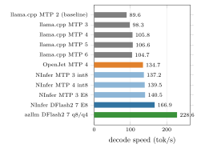
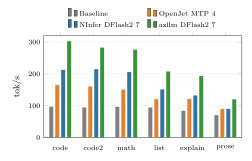
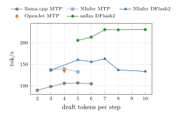
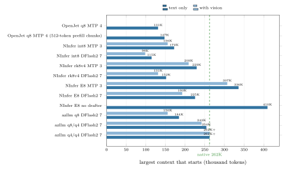
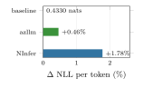
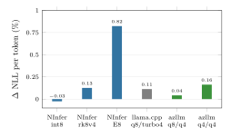

# Faster Qwen3.8-27B on the RTX 4090

> [!NOTE]
> This is the report of the research behind qwen-4090-bench, kept as a reference with everything needed to reproduce it: the paper ([`Serving-Qwen3.8-27B-on-a-single-RTX-4090.pdf`](Serving-Qwen3.8-27B-on-a-single-RTX-4090.pdf), sources in [`paper/`](paper/)), the measurements ([`results/`](results/)) and the scripts that made them ([`bench/`](bench/) and the `qwen-*.sh` servers). Those scripts ran each engine in a container of its own, from a folder that also held the engines' sources (`src/`) and the models (`models/`), which are not copied here. For running the servers, use the packaged project at the root of this repository: see its [README](../../README.md).

## Table of Contents <!-- omit in toc -->

- [The Short Answer](#the-short-answer)
- [Which Script to Use](#which-script-to-use)
- [How to Run Each Server](#how-to-run-each-server)
  - [azllm](#azllm)
  - [NInfer](#ninfer)
  - [OpenJet](#openjet)
  - [Baseline: llama.cpp](#baseline-llamacpp)
  - [Differences for Clients](#differences-for-clients)
  - [Switching Servers from opencode with llama-swap](#switching-servers-from-opencode-with-llama-swap)
- [Speed](#speed)
- [Context Size](#context-size)
  - [Room for the Display](#room-for-the-display)
- [Precision](#precision)
  - [The Weights](#the-weights)
  - [The KV Cache](#the-kv-cache)
  - [Benchmarks](#benchmarks)
- [Temperature](#temperature)
- [How the Measurements Were Made](#how-the-measurements-were-made)
- [The Folder](#the-folder)
- [Sources](#sources)

## The Short Answer

We compared five ways to run Qwen3.8-27B on an NVIDIA RTX 4090 (24 GB). The reference baseline is llama.cpp with the TurboQuant KV cache types ([TheTom/llama-cpp-turboquant](https://github.com/TheTom/llama-cpp-turboquant)), serving Unsloth's `UD-Q4_K_XL` GGUF with MTP speculative decoding (2 drafts), `q8_0` keys and `turbo4` values, and 128K context. The four other engines are faster. The best one is **[azllm](https://github.com/xhinker/azllm)**, a fork of [tqLLM](https://github.com/turbo-tan/tqllm):

- **2.5x faster**: 229 tok/s against 90 for the baseline, and about 300 tok/s on code.
- **Almost twice the context, with vision**: 242K tokens instead of 128K, or the full 262K with a 4-bit KV cache. A card that also drives the display holds less: 148K and 228K with 2 GB left free for it (see [Room for the Display](#room-for-the-display)).
- **As precise as the baseline**: on code its weights predict within 0.5% of the baseline's, its KV cache costs less than the baseline's, and the benchmarks are within noise.
- **Tool calls work**: the script uses a fixed chat template for coding agents.

Start it with:

```
./qwen-azllm.sh start
```

## Which Script to Use

Every script starts a server on port 8084 and stops any other server first: only one fits on the GPU.

| Script | Context | Vision | Short prompts | Thinking | 29K prompt | GSM8K | HumanEval |
|---|---:|:---:|---:|---:|---:|---:|---:|
| `./qwen-baseline.sh start` | 128K | yes | 89.6 tok/s | 84.2 | 76.0 | 97.2% | 96.3% |
| `./qwen-openjet.sh start` | 128K | no | 135.9 tok/s | 130.2 | 110.7 | 95.6% | 96.3% |
| `./qwen-ninfer.sh start precise` | 200K | yes | 137.4 tok/s | 129.7 | 122.2 | 97.6% | 95.1% |
| `./qwen-ninfer.sh start long` | 256K | yes | 139.0 tok/s | 131.0 | 121.8 | 96.0% | 96.3% |
| `./qwen-ninfer.sh start fast` | 192K | yes | 166.0 tok/s | 153.3 | 132.8 | 97.2% | 95.7% |
| **`./qwen-azllm.sh start`** | **242K** | yes | **228.6 tok/s** | **208.4** | **150.1** | 95.2% | 95.7% |
| `./qwen-azllm.sh start --kv q4/q4 --ctx 262144` | **256K** | yes | **228.8 tok/s** | 195.1 | 145.6 | 96.8% | 95.7% |

Speeds are tokens per second while writing the answer. The accuracy differences are 1 to 5 problems out of 164 and 250, which is within the noise of these tests (see [Benchmarks](#benchmarks)).

Our recommendation for coding: **`./qwen-azllm.sh start`**. Add `--kv q4/q4 --ctx 262144` when the full 256K context is needed; it costs almost nothing in precision (see [The KV Cache](#the-kv-cache)).

## How to Run Each Server

Each script has four commands: `start`, `stop`, `logs`, and `run`, which keeps the server in the foreground for llama-swap. `--port N` serves on another port than 8084. The server is ready when the script prints `ready on http://localhost:8084/v1`. The container is removed by `stop` or by the next `start`, and does not start at boot. If a server does not start, `logs` shows why. Switching from one server to another takes about a minute: the script waits until the port is released. All scripts use the sampling settings recommended for the model: temperature 0.6, top-p 0.95, top-k 20, min-p 0.

### azllm

azllm reads its own weight file, `TQ_L` (14.7 GB, 4.31 bits per weight), and drafts 7 tokens per step with DFlash2:

```
./qwen-azllm.sh start
```

| Option | Default | Description |
|---|---|---|
| `--ctx N` | `241664` | context size in tokens |
| `--kv FORMAT` | `q8/q4` | KV cache: `q8/q4` (8-bit keys, 4-bit values), `q4/q4` or `q8` |
| `--drafts N` | `7` | draft tokens per step; 7 to 10 are equally fast, 5 and 6 slower |
| `--no-vision` | | text only |

The largest contexts that fit:

| KV cache | With vision | Text only |
|---|---:|---:|
| `q8/q4` | 241,664 | 253,952 |
| `q4/q4` | 262,144 (the full window) | 262,144 |
| `q8` | 155,648 | 184,320 |

These leave azllm's default 768 MiB of the GPU free. With the room a desktop needs, they are smaller: see [Room for the Display](#room-for-the-display).

The server keeps the previous request's cache, so a conversation that grows is not read again: a 219K-token prompt took 147 seconds to read, and the next request, the same prompt plus 15K new tokens, 15 seconds.

### NInfer

[NInfer-4090](https://github.com/sergiuszm/ninfer-4090), with three profiles:

```
./qwen-ninfer.sh start long
./qwen-ninfer.sh start precise
./qwen-ninfer.sh start fast
```

| Profile | Context | KV cache | Drafter |
|---|---:|---|---|
| `long` (default) | 262,144 | `rk4v4-e8`: 4-bit keys and values | MTP, 3 tokens |
| `precise` | 204,800 | `rk8v4`: 8-bit keys, 4-bit values | MTP, 3 tokens |
| `fast` | 192,512 | `rk4v4-e8`: 4-bit keys and values | DFlash2, 7 tokens |

Every profile includes vision. Options after the profile change it: `--ctx N`, `--kv int8|rk8v4|rk4v4-e8`, `--spec mtp|dflash2|none`, `--drafts N` and `--no-vision`.

`./qwen-fast.sh start` is the first fast server of this work, NInfer with DFlash2 at 128K. It is kept as it was.

### OpenJet

[OpenJet](https://github.com/L-Forster/open-jet/tree/master/megakernel) reads the same model file as the baseline. It has no vision:

```
./qwen-openjet.sh start
```

Options: `--ctx N` (default `131072`, at most `147456`), `--kv q8|f16` and `--drafts N` (0 to 4, default 4).

### Baseline: llama.cpp

The reference baseline, `llama-qwen3.8-27B.sh` of the turboquant repository, in a container, with the same model and options:

```
./qwen-baseline.sh start
```

Options: `--ctx N` and `--no-vision`.

### Differences for Clients

- **azllm, OpenJet and the baseline** accept the same requests as before, `chat_template_kwargs` included.
- **NInfer** rejects `chat_template_kwargs`: send `enable_thinking` and `reasoning_effort` as top-level fields. It accepts `reasoning_effort` `low`, `medium`, `xhigh` or `none`, not `high`.
- **azllm** caps every answer, thinking included, at 16,384 tokens.

### Switching Servers from opencode with llama-swap

[llama-swap](https://github.com/mostlygeek/llama-swap) is a proxy that starts the server a request asks for and stops the one that was running. With it, picking a model in opencode starts that engine. Start it with:

```
./qwen-swap.sh start
```

It listens on `http://127.0.0.1:8085/v1` and offers seven models: `azllm`, `azllm-256k`, `ninfer-long`, `ninfer-precise`, `ninfer-fast`, `openjet` and `baseline`. Its configuration is [`llama-swap/config.yaml`](llama-swap/config.yaml): each model runs its server script with `run`, which keeps the server in the foreground, and `--port`, the port llama-swap chooses. The first request to a model waits for its server to load, up to two minutes. `./qwen-swap.sh stop`, `logs` and `status` stop it, follow its log and show the running model.

opencode has a provider `qwen-swap` in `~/.config/opencode/opencode.json`, with the seven models and their context sizes; `qwen-swap/azllm` is the default. Choose a model with `/models`. Do not start a server script by hand while llama-swap is running: only one server fits on the GPU.

## Speed

Measured on six short prompts (two coding tasks, a story, an explanation, a math problem, a table), with the recommended sampling settings and thinking off, from the first token of the answer to the last.



The engines guess several tokens ahead with a small draft model and the big model checks them all at once. So the speed depends on how predictable the text is: code and math go 3x faster than the baseline, a story only 1.7x.



More draft tokens help up to a point. azllm is best from 7 drafts on; NInfer's DFlash2 drops beyond 7, and MTP is best at 3 to 5.



## Context Size

The largest context each setup can start with, found by trying sizes 4,096 tokens apart. The dashed line is the model's full 262K window:



Starting is not proof that a context works, since a long prompt needs extra memory. So we filled each setup to its limit with source code and asked 12 questions about it: "copy the first 16 lines of function X in file Y". Every server answered and stayed up, and the ones with vision still described an image afterwards.

| Setup | Tokens in context | Correct | Speed while answering |
|---|---:|---:|---:|
| Baseline, vision | 121,375 | 11 of 12 (1) | 55 tok/s |
| OpenJet | 142,807 | 12 of 12 | 125 tok/s |
| NInfer `fast`, vision | 184,886 | 12 of 12 | 115 tok/s |
| NInfer `precise`, vision | 196,772 | 12 of 12 | 110 tok/s |
| NInfer `precise`, no vision | 221,095 | 11 of 12 (2) | 106 tok/s |
| NInfer `long`, vision | 252,392 | 12 of 12 | 108 tok/s |
| azllm `q8/q4`, vision | 233,777 | 11 of 12 (1) | 132 tok/s |
| azllm `q4/q4`, vision | 252,392 | 12 of 12 | **162 tok/s** |

1. The code contains the text `<|im_start|>`, which the engine treats as a special token and removes from the answer. The rest was exact.
2. The answer left out the first line, `try {`, and copied the other 15 exactly.

With a full context the baseline slows down to 55 tok/s; azllm keeps 132 to 162 tok/s.

### Room for the Display

The capacities above leave each engine's default free memory on the GPU: 768 MiB for azllm. On our computer the same RTX 4090 also drives the display, and the desktop holds about 1 GB of its memory: Xorg, gnome-shell and the open windows, which `nvidia-smi` lists as type `G`. It grows as windows open. With the desktop running, azllm `q8/q4` at 241,664 tokens and even at 221,184 refuses to start, with `does not fit as asked (1 slot(s), context 241664 per slot, KV q8/q4): it would need prefill buffers -ub 512, prefill FP16 weight blocks of 2048 rows`.

The KV cache is not what grows: azllm reserves it whole at start. What grows is the desktop, and azllm's cache of CUDA graphs. So the packaged project keeps 2 GB free after loading, with `-fitt 2048`, and serves the largest contexts that start with that room, found as above, 4,096 tokens apart, with vision and the desktop running:

| azllm KV cache | Above, 768 MiB free | 2 GB free, desktop running |
|---|---:|---:|
| `q8/q4` | 241,664 | 151,552 |
| `q4/q4` | 262,144 | 233,472 |

The room costs `q8/q4` about 90K tokens and `q4/q4` only 29K, although `q4/q4` needs fewer bytes per token. Near the `q8/q4` limit, what does not fit is the full-size prefill buffers, not the KV cache: every refusal asks for smaller prefill buffers. With the room for a display, `q4/q4` is the azllm configuration with the most context. Decode speed hardly depends on the context size (228.5 tok/s at 241,664 tokens with vision, 230.4 at 131,072 without), so the speeds of this report hold for the smaller contexts.

We did not measure the other engines again with the display: their capacities above leave their default free memory, and may not start next to a desktop.

## Precision

We checked precision in three ways: how well the weights predict code, how much each KV cache format loses, and benchmark scores.

### The Weights

Each engine reads a different 4-bit version of the model. We measured how well each predicts 98,304 tokens of C++/CUDA code, on exactly the same positions with 32K to 64K tokens of context before each. Lower is better; the baseline is the reference:



azllm's file is smaller (14.7 GB against 17.6 GB) but loses only 0.46%; NInfer's loses 1.78%. These numbers include each engine's arithmetic, and none of the three is the original 16-bit model.

### The KV Cache

The KV cache is the model's memory of the context. Fewer bits fit more context but add small errors. Each bar is the loss of a format against the most precise one of the same engine, with 32K to 64K tokens of context:



- **azllm `q8/q4`** costs 0.04%, less than the baseline's `q8_0`/`turbo4` cache (0.11%).
- **azllm `q4/q4`**, the one that fits the full 256K, costs 0.16%. Its top choice of next token agrees with the 8-bit cache 99.1% of the time.
- **NInfer's 4-bit `rk4v4-e8`** costs 0.82%: azllm's 4-bit cache is five times more precise.

In practice none of this was visible: every setup copied 16-line functions exactly from anywhere in contexts up to 252K tokens.

### Benchmarks

Greedy decoding, thinking off, 250 GSM8K math problems and the 164 HumanEval coding problems, in the [table above](#which-script-to-use). azllm solves 238 to 242 of 250 GSM8K problems against 243 for the baseline, and 157 of 164 HumanEval problems against 158. These differences are the noise of the tests: OpenJet, which reads exactly the baseline's weights, solves 239 GSM8K problems, and azllm solves more with its less precise 4-bit cache (242) than with the 8-bit one (238).

## Temperature

The machine reset once during this work, under a long full-power load, without any GPU error in the system log. The GPU draws up to 450 W, and its fans spin slowly by design (43% at 77 °C), so the heat stays in the case.

> [!IMPORTANT]
> Keep the case well ventilated during long runs.

[`bench/thermal-guard.sh`](bench/thermal-guard.sh) logs the GPU and CPU temperatures every 10 seconds to `results/thermal.log`. It pauses the benchmark containers when the GPU reaches 83 °C or the CPU 90 °C, until both are under 75 °C. Start it before long runs:

```
nohup bench/thermal-guard.sh >/dev/null 2>&1 &
```

Stop it with `pkill -f thermal-guard.sh` and `docker rm -f qr-gpustats`. During the rest of the work the GPU peaked at 80 °C and the guard never had to pause.

> [!NOTE]
> `nvidia-smi` is missing on this machine: the package `nvidia-utils-580` is not installed, although the driver is. `sudo apt install nvidia-utils-580` brings it back.

## How the Measurements Were Made

Every number of this report comes from a script in `bench/`, run against a server started with one of the `qwen-*.sh` scripts on port 8084. Each runs in a throw-away container.

| Measurement | Script |
|---|---|
| Speed on the six short prompts, thinking, greedy | `bench/bench.py --url http://127.0.0.1:8084 --model Qwen3.8-27B --label <name> [--think] [--greedy]` |
| Speed with a 29K-token prompt | `bench/bench.py ... --long 100000` |
| GSM8K and HumanEval | `bench/evalacc.py --url http://127.0.0.1:8084 --model Qwen3.8-27B --label <name>` |
| Full context: fill, ask 12 questions, check the server and vision | `bench/fill-run.sh`, which runs `bench/longctx.py` and `bench/vision-check.py` |
| Speed, accuracy and vision of one server script | `bench/profile-run.sh "<name>\|<script and options>\|kwargs"` |
| Largest context: NInfer, OpenJet, azllm | `bench/probe-ninfer.sh`, `bench/probe-openjet.sh`, `bench/probe-tqllm.sh` |
| What azllm moves to host memory near its limit | `bench/check-tqllm-fit.sh` |
| KV cost on code: llama.cpp, NInfer, azllm | `bench/ppl-llama.sh`, `bench/ppl-ninfer.sh`, `bench/kld-tqllm.sh` |
| Weight comparison on the same positions | `bench/weights-compare.sh`, then `python3 bench/weights-compare.py` |
| Tool call | `bench/toolcall-check.py` |
| Temperature log and guard | `bench/thermal-guard.sh` |

`<name>` is any label; the results are appended to the files in `results/`.

> [!IMPORTANT]
> For NInfer, add `--no-think top` to `bench.py`, `evalacc.py` and `longctx.py`: NInfer rejects `chat_template_kwargs` and takes `enable_thinking` as a top-level field.

`bench/ppl-ninfer.sh` needs `bin/ninfer-perplexity`, NInfer's perplexity tool built from `src/ninfer-4090` with a small patch to `apps/perplexity/main.cpp` that lets it accept the `rk8v4` and `rk4v4-e8` KV formats the server already supports.

## The Folder

| Path | What it holds |
|---|---|
| `REPORT.md` | This report |
| `Serving-Qwen3.8-27B-on-a-single-RTX-4090.pdf` | The paper |
| `paper/` | The paper's LaTeX sources and figures; `paper/build.sh` rebuilds the PDF, `paper/render-figures.sh` the images |
| `images/` | The plots of this report, in SVG |
| `results/` | Every measurement: speed (`bench_summary.jsonl`, `bench.jsonl`), accuracy (`accuracy.jsonl`), full-context recall with every answer (`longctx.jsonl`), capacities (`*-capacity.txt`), perplexities (`ppl-*.txt`, `tqkld.txt`, `ppl-ninfer-int8-64k/`), the weight comparison (`weights-compare-table.txt`, `tqkld/*.nll.f32`) and the temperature log |
| `bench/` | The measurement scripts |
| `qwen-*.sh`, `scripts/common.sh` | The servers as the research ran them, one container each |
| `qwen-swap.sh`, `llama-swap/config.yaml` | llama-swap in front of those servers |
| `docker/` | The research images: CUDA 12.8 for llama.cpp, OpenJet and azllm, LaTeX for the paper, and the container runner |

## Sources

- [ggml-org/llama.cpp](https://github.com/ggml-org/llama.cpp)
- [TheTom/llama-cpp-turboquant](https://github.com/TheTom/llama-cpp-turboquant), the baseline
- [L-Forster/open-jet](https://github.com/L-Forster/open-jet), OpenJet
- [Neroued/ninfer](https://github.com/Neroued/ninfer) and [sergiuszm/ninfer-4090](https://github.com/sergiuszm/ninfer-4090), NInfer
- [turbo-tan/tqllm](https://github.com/turbo-tan/tqllm) and [xhinker/azllm](https://github.com/xhinker/azllm), azllm
- [mostlygeek/llama-swap](https://github.com/mostlygeek/llama-swap)
